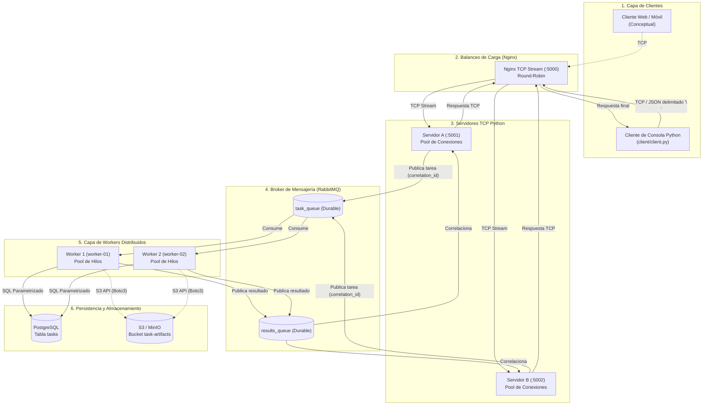

# Sistema Distribuido de Ejecución de Tareas (PFO 3)

**Materia:** Programación de Redes  
**Proyecto:** PFO 3 — Rediseño como Sistema Distribuido (Cliente-Servidor) con Sockets TCP, RabbitMQ, Workers Multihilo, PostgreSQL, Nginx y S3.

---

## 1. 📌 Descripción del Proyecto

Este proyecto implementa una **aplicación distribuida completa en Python** orientada al procesamiento concurrente y desacoplado de tareas. Los clientes se conectan a través de **sockets TCP** hacia instancias de servidores Python balanceadas mediante **Nginx TCP stream**. 

Los servidores validan los mensajes, registran el estado inicial en **PostgreSQL** y publican las tareas en una cola persistente de **RabbitMQ**. Un conjunto de **workers independientes** (con pools de hilos configurables) consume las tareas, ejecuta de forma segura operaciones numéricas estrictamente registradas (`sum`, `multiply`, `max`), persiste los metadatos y resultados en PostgreSQL (y opcionalmente artefactos en **S3 / MinIO**), y devuelve el resultado al cliente correspondiente mediante el patrón **RPC / Correlation ID**.

---

## 2. 🏛️ Arquitectura del Sistema



El diagrama en formato Mermaid fuente se encuentra en [`diagrams/architecture.mmd`](diagrams/architecture.mmd).

---

## 3. 🛠️ Tecnologías Utilizadas

| Componente | Tecnología | Rol en la Arquitectura |
| :--- | :--- | :--- |
| **Lenguaje Principal** | Python 3.11 / 3.13 | Backend, servidores, clientes y workers |
| **Protocolo de Red** | Sockets TCP | Comunicación cliente-servidor con delimitador `\n` |
| **Formato de Mensajes** | JSON UTF-8 | Serialización/deserialización con encuadre de stream |
| **Concurrencia** | `ThreadPoolExecutor` | Pools de hilos tanto en servidores como en workers |
| **Cola de Mensajes** | RabbitMQ (v3.13) | Broker AMQP durable para desacoplamiento asíncrono |
| **Cliente AMQP** | `pika` | Comunicación con RabbitMQ (patrón RPC con `correlation_id`) |
| **Base de Datos** | PostgreSQL (v16) | Persistencia relacional de estados, resultados y auditoría |
| **Driver PostgreSQL** | `psycopg2-binary` | Consultas SQL parametrizadas para evitar inyección SQL |
| **Almacenamiento de Objetos** | AWS S3 / MinIO (`boto3`) | Persistencia de artefactos y payloads extensos |
| **Balanceador de Carga** | Nginx (`stream` TCP) | Balanceo Round-Robin entre instancias de servidor |
| **Pruebas Automatizadas** | `pytest` | Suite de 26 pruebas unitarias, resiliencia e integración |
| **Contenedores** | Podman / Docker Compose | Despliegue reproducible de servicios auxiliares |

---

## 4. 📁 Estructura del Proyecto

```text
pfo3/
├── README.md                  # Documentación integral del sistema
├── .env.example               # Plantilla de variables de entorno
├── .gitignore                 # Exclusiones de control de versiones
├── requirements.txt           # Dependencias de Python
├── Dockerfile                 # Imagen de contenedor para nodos Python
├── docker-compose.yml         # Despliegue completo con Podman / Docker
├── demo_distributed.py        # Script de demostración interactiva
│
├── config/
│   ├── __init__.py
│   └── settings.py            # Configuración centralizada vía dotenv/pydantic
│
├── client/
│   ├── __init__.py
│   └── client.py              # Cliente interactivo de consola y SDK reusable
│
├── server/
│   ├── __init__.py
│   ├── protocol.py            # Protocolo TCP, validación y message framing
│   ├── dispatcher.py          # Despachador de tareas hacia RabbitMQ y BD
│   ├── task_manager.py        # Gestor de eventos y correlación RPC en memoria
│   └── tcp_server.py          # Servidor TCP concurrente multi-hilo
│
├── workers/
│   ├── __init__.py
│   ├── operations.py          # Registro seguro de operaciones (sum, multiply, max)
│   └── worker.py              # Proceso Worker distribuido con ThreadPool
│
├── messaging/
│   ├── __init__.py
│   └── rabbitmq_client.py     # Cliente resiliente de RabbitMQ (AMQP 0-9-1)
│
├── storage/
│   ├── __init__.py
│   ├── postgres.py            # Persistencia en PostgreSQL con SQL parametrizado
│   └── s3_storage.py          # Conector a MinIO / AWS S3 para artefactos
│
├── database/
│   └── init.sql               # Script DDL de inicialización de PostgreSQL
│
├── deploy/
│   └── nginx.conf             # Configuración TCP stream del balanceador Nginx
│
├── diagrams/
│   └── architecture.mmd       # Diagrama de arquitectura Mermaid
│
└── tests/
    ├── __init__.py
    ├── conftest.py
    ├── test_protocol.py       # Pruebas de serialización, fragmentación y validación
    ├── test_operations.py     # Pruebas de suma, multiplicación, máximo y seguridad
    ├── test_client_server.py  # Pruebas de conexión TCP, concurrencia y resiliencia
    ├── test_dispatcher.py     # Pruebas de correlación y timeouts
    ├── test_persistence.py    # Pruebas de SQL parametrizado y estados
    └── test_live_distributed_flow.py # Prueba E2E real con RabbitMQ y Postgres
```

---

## 5. ⚙️ Instalación y Configuración

### 5.1 Requisitos Previos
- **Python 3.10+** (probado en Python 3.13).
- **Podman** o **Docker** (para servicios de infraestructura: RabbitMQ y PostgreSQL).

### 5.2 Instalación de Dependencias
```powershell
pip install -r requirements.txt
```

### 5.3 Configuración de Variables de Entorno
Copiar el archivo `.env.example` a `.env`:
```powershell
cp .env.example .env
```
Ajustar los parámetros de conexión según el entorno (e.g. host de RabbitMQ y PostgreSQL).

---

## 6. 🚀 Instrucciones de Ejecución

### Opción A: Despliegue con Podman / Docker Compose (Recomendado)
Para iniciar la infraestructura de base de datos, broker de mensajes, balanceador y nodos:
```powershell
podman compose up -d
```
O con Docker:
```bash
docker compose up -d
```

### Opción B: Ejecución Modular / Local
Si los contenedores de PostgreSQL y RabbitMQ ya están iniciados:

1. **Iniciar el Servidor TCP (Nodo A)** (Terminal 1):
   ```powershell
   python -m server.tcp_server --port 5001 --server-id server-node-a
   ```

2. **Iniciar un Worker Concurrente** (Terminal 2):
   ```powershell
   python -m workers.worker --worker-id worker-01 --threads 4
   ```

3. **Iniciar un Segundo Worker** (Terminal 3):
   ```powershell
   python -m workers.worker --worker-id worker-02 --threads 4
   ```

4. **Ejecutar el Cliente Interactivo** (Terminal 4):
   ```powershell
   python -m client.client --host 127.0.0.1 --port 5001
   ```

### Opción C: Script de Demostración Automática (Todo en Uno)
Para verificar la suite completa en acción con un solo comando:
```powershell
python demo_distributed.py
```

---

## 7. 🧪 Pruebas Automatizadas

La suite cuenta con **26 pruebas automatizadas** que cubren todos los niveles: unitarias, integración, resiliencia y concurrencia.

Para ejecutar todas las pruebas:
```powershell
pytest tests -v
```

### Resumen de Pruebas:
- `test_protocol.py`: Verificación de serialización JSON UTF-8, delimitación de mensajes, control de fragmentación TCP y agrupación de paquetes.
- `test_operations.py`: Verificación de `sum`, `multiply`, `max`, rechazo de listas vacías, tipos no válidos y operaciones desconocidas.
- `test_client_server.py`: Comunicación real TCP sobre sockets, múltiples clientes concurrentes, persistencia de sesión y resiliencia ante clientes desconectados abruptamente.
- `test_dispatcher.py`: Sincronización multi-hilo, correlación de solicitudes y control de timeouts.
- `test_persistence.py`: Seguridad contra inyección SQL mediante consultas parametrizadas.
- `test_live_distributed_flow.py`: Prueba de integración extremo a extremo contra PostgreSQL y RabbitMQ reales.

---

## 8. 📊 Evidencia de Funcionamiento

Ejemplo de ejecución del script de demostración `demo_distributed.py`:

```text
======================================================================
   DEMOSTRACIÓN DEL SISTEMA DISTRIBUIDO PFO 3 (PROGRAMACIÓN DE REDES)
======================================================================

[Fase 1] Conectando a PostgreSQL e inicializando esquema DDL...
[OK] Esquema verificado en PostgreSQL (tabla 'tasks').

[Fase 2] Iniciando 2 Workers concurrentes...
[OK] Worker 1 (ID: worker-01) y Worker 2 (ID: worker-02) activos consumiendo de RabbitMQ.

[Fase 3] Iniciando Servidor TCP en puerto 5090...
[OK] Servidor TCP escuchando en 127.0.0.1:5090.

[Fase 4] Enviando tareas computacionales desde Cliente TCP...

--> [Tarea 1] Enviar 'sum' con [10, 20, 30]
    Respuesta: status=completed, result=60, worker=worker-02

--> [Tarea 2] Enviar 'multiply' con [4, 5, 2]
    Respuesta: status=completed, result=40, worker=worker-01

--> [Tarea 3] Enviar 'max' con [15, 89, 42, 3]
    Respuesta: status=completed, result=89, worker=worker-02

--> [Tarea 4] Enviar operación desconocida 'logaritmo' (Prueba CA-03)
    Respuesta Error Controlado: code=INVALID_TASK, message=La operación solicitada 'logaritmo' no es válida. Permitidas: sum, multiply, max

[Fase 5] Consultando registros históricos persistidos en PostgreSQL:
---------------------------------------------------------------------------
TASK ID          | OPERACIÓN  | ESTADO     | RESULTADO  | WORKER      
---------------------------------------------------------------------------
demo-task-03     | max        | completed  | 89.0       | worker-02   
demo-task-02     | multiply   | completed  | 40.0       | worker-01   
demo-task-01     | sum        | completed  | 60.0       | worker-02   
task-live-e2e-001 | sum        | completed  | 60.0       | worker-live-01
---------------------------------------------------------------------------

[OK] Demostración completada con éxito rotundo. Todos los criterios verificados.
```

---

## 9. ⚖️ Cumplimiento de Criterios de Aceptación (OpenSpec)

| Criterio | Descripción | Estado | Verificación |
| :--- | :--- | :---: | :--- |
| **CA-01** | Conexión cliente-servidor TCP funcional | ✅ Cumplido | `tests/test_client_server.py`, `client/client.py` |
| **CA-02** | Resultado correcto: `sum([10, 20, 30]) = 60` | ✅ Cumplido | Verificado en cliente y en base de datos |
| **CA-03** | Rechazo controlado de operaciones no permitidas | ✅ Cumplido | Operaciones registradas; rechazo con código `INVALID_TASK` |
| **CA-04** | Concurrencia mediante pools de hilos | ✅ Cumplido | `ThreadPoolExecutor` en servidores y workers |
| **CA-05** | Distribución visible entre múltiples workers | ✅ Cumplido | Logs y respuestas diferencian `worker-01` y `worker-02` |
| **CA-06** | Desacoplamiento real mediante RabbitMQ | ✅ Cumplido | Colas durables `task_queue` y `results_queue` con confirmaciones `ack` |
| **CA-07** | Persistencia real en PostgreSQL | ✅ Cumplido | Tabla `tasks` con timestamps, worker_id, status y resultados |
| **CA-08** | Manejo de errores y resiliencia | ✅ Cumplido | Clientes malformados o caídos no tiran el servidor |
| **CA-09** | Balanceo de carga de conexiones | ✅ Cumplido | `deploy/nginx.conf` con módulo TCP `stream` |
| **CA-10** | Documentación y reproducibilidad | ✅ Cumplido | README detallado con instrucciones paso a paso |
| **CA-11** | Diagrama de arquitectura completo | ✅ Cumplido | `diagrams/architecture.mmd` con todos los componentes |
| **CA-12** | Entregables completos en el repositorio | ✅ Cumplido | Código fuente, tests, configs y diagramas presentes |

---

## 10. ⚠️ Limitaciones Conocidas y Extensiones Futuras

1. **Almacenamiento S3 / MinIO**: El código incluye la integración completa con `boto3` para persistir artefactos grandes en S3. En entornos donde MinIO no está levantado, el worker desactiva de forma transparente el almacenamiento de artefactos y conserva el resultado directamente en PostgreSQL.
2. **Heartbeats en entornos de alta latencia**: En redes con alta latencia, el parámetro `heartbeat` de RabbitMQ puede requerir ajuste en `config/settings.py` para evitar desconexiones prematuras de sockets inactivos.
